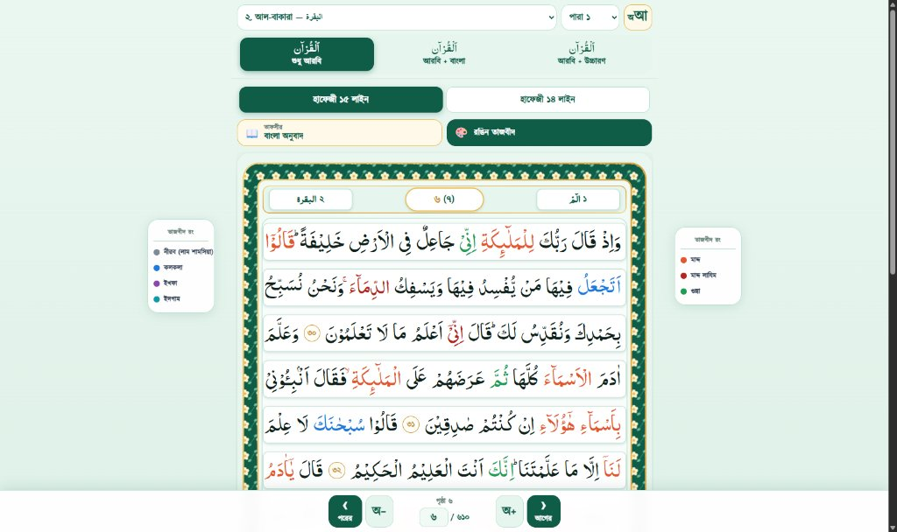
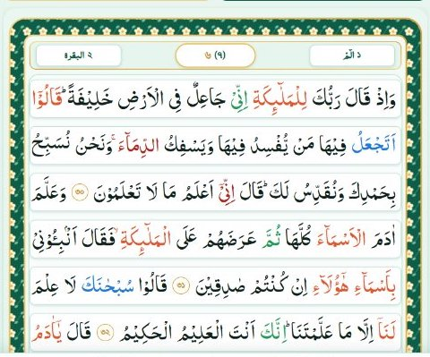

# 📖 Qariana Quran — Complete Edition 4 Architecture & Buildable Codebase Bundle

[](https://karianaquran.com)
[](https://karianaquran.com)
[](https://karianaquran.com)

This repository contains the **complete buildable Android project**, the **complete 611-page 15-line Hafezi Mushaf dataset**, reference UI screenshots, APK builds, and architectural specifications for integrating **Edition 4 (Hafezi 15-Line & 14-Line Vector Mushaf)** and future Quran editions into the **Official Qariana Quran Native Android Application** (`com.karianaquran.reader`).

---

## 📌 Quick Access Links for AI Reviewers (Claude 3.7 / External AI)

- 🤖 **[PROMPT_FOR_CLAUDE_AI.md](./PROMPT_FOR_CLAUDE_AI.md)**: **The Primary Master Prompt** to feed into Claude AI.
- 📐 **[PROJECT_ARCHITECTURE_AND_ROADMAP.md](./PROJECT_ARCHITECTURE_AND_ROADMAP.md)**: Exhaustive architectural roadmap, database schema, and bridge design.
- 📱 **[Android Full Project Source](./3_android_app_source/)**: Complete, buildable Android Studio Gradle project (`app/`, `build.gradle.kts`, `settings.gradle.kts`, `gradlew`).
- 🌐 **[Web Reader Codebase & Complete Datasets](./2_web_reader_codebase/)**: 
  - All **611 JSON pages** of the 15-line Hafezi Mushaf (`data/qudratullah_pages/`).
  - 14-line template SVGs and layout data (`data/layout14/`).
  - High-performance SVG vector Mushaf renderer with Tajweed colors, Word-by-Word Bengali meanings, and dynamic layout scaling.
- 🖼️ **[Screenshots & Visual Specs](./4_screenshots_reference/)**: Visual comparison showing how the Web Reader transforms into Native Android Compose UI.
- 📦 **[APKs](./1_APKs/)**: Previous release (v1.3.11) and current build (v1.3.12).

---

## 🎯 The Core Architectural Mission

### Visual Comparison: Standalone Web vs. Native Android Viewport

| Standalone Web Reader (Image 1) | Target Android Compose Viewport (Image 2) |
| :---: | :---: |
|  |  |
| **All controls on web page** (Surah/Para dropdowns, 15/14 line buttons, Mode buttons, bottom pagination) | **ZERO web controls**. ONLY the pure Mushaf SVG page frame renders. Native Jetpack Compose handles TopBar, BottomDock, and Sheets! |

### Fundamental Rules:
1. **Clean Viewport Inside Android**: In the Android app, the WebView must **NEVER** render top headers, bottom pagination bars, or HTML modal popups. It must ONLY render the beautiful SVG Mushaf page frame (`#mushaf-viewport`).
2. **Native Controls**:
   - 15-Line vs 14-Line switch: Controlled via Native Jetpack Compose Bottom Bar / Settings Sheet.
   - Reading Mode (Arabic Only / Arabic + Meaning / Arabic + Pronunciation): Controlled via Native Compose UI.
   - Color Tajweed Toggle: Controlled via Native Compose UI.
   - Surah / Para / Page jumps: Handled by Compose Top Bar and Surah Index Bottom Sheet.
3. **Multi-Edition Scalability**: The app currently has 3 editions (`ortho_quran`, `tajweed_quran`, `word_by_word`). We are integrating **Edition 4 (`hafezi_15_14_lines`)** and setting up a modular architecture for Edition 5, Edition 6, etc.
4. **Subscription & 10-Page Free Preview**: Pages 1 to 10 are free to read. Swiping to Page 11 displays the native purchase/unlock modal unless unlocked with user credentials (`Mobile Number + License Key KQ-XXXX-XXXX-XXXX`).
5. **Mandatory In-App Update**: Whenever a new APK version is released, previous versions must strictly enforce a mandatory update dialog blocking access until updated.

---

## 📂 Repository Structure

```
qariana-quran-edition4-bundle/
├── README.md                                  # Repository overview (this file)
├── PROMPT_FOR_CLAUDE_AI.md                    # Master prompt for Claude AI review
├── PROJECT_ARCHITECTURE_AND_ROADMAP.md        # Complete technical specification
├── 1_APKs/                                    # Android APK builds
│   ├── QarianaQuran-v1.3.11-stable-previous.apk  (41.7 MB - v1.3.11 stable)
│   └── QarianaQuran-v1.3.12-latest-build.apk     (39.8 MB - v1.3.12 latest)
├── 2_web_reader_codebase/                     # Standalone 15/14 Line Vector Engine
│   ├── index.html                             # Web reader entrypoint
│   ├── assets/
│   │   ├── css/                               # Responsive Mushaf styles & animations
│   │   ├── fonts/                             # Custom glyph Arabic & Kalpurush fonts
│   │   ├── js/                                # Dynamic layout generator & SVG renderer
│   │   └── mushaf_bg/                         # 12 high-res SVG decorative borders
│   └── data/
│       ├── qudratullah_pages/                 # Complete 611 JSON page files (Pages 1 to 611)
│       ├── layout14/                          # 14-line layout configuration & templates
│       ├── bn-translation.json                # Full Bengali Ayah translation dataset
│       ├── bn-wbw-full.json                   # Full Bengali Word-by-Word dataset
│       └── surahs.json, juzs.json             # Quran index metadata
├── 3_android_app_source/                      # COMPLETE BUILDABLE ANDROID STUDIO PROJECT
│   ├── build.gradle.kts                       # Root project build configuration
│   ├── settings.gradle.kts                    # Project settings (:app module)
│   ├── gradle.properties                      # Gradle JVM & build optimization flags
│   ├── gradlew, gradlew.bat                   # Gradle wrapper executables
│   ├── gradle/wrapper/                        # Gradle wrapper distribution
│   └── app/                                   # Application Module
│       ├── build.gradle.kts                   # Dependencies & plugins (Compose, Hilt, Firebase)
│       ├── proguard-rules.pro                 # R8/Proguard rules
│       ├── google-services.json               # Firebase configuration
│       └── src/main/
│           ├── AndroidManifest.xml            # App manifest (FLAG_SECURE, permissions)
│           ├── java/com/karianaquran/reader/  # Complete Kotlin Compose source code
│           ├── res/                           # Layouts, drawables, fonts, themes, strings
│           └── assets/                        # Quran page datasets & offline mushaf assets
└── 4_screenshots_reference/                   # 10 High-Resolution UI Screenshots
    ├── image_1_full_web_reader.png            # Full web reader reference
    ├── image_2_target_mushaf_frame_only.png   # Target in-app viewport reference
    ├── p1_fatiha_opening_arch.png             # Surah Al-Fatiha ornamental arch
    ├── p2_baqarah_opening_arch.png            # Surah Al-Baqarah ornamental arch
    ├── p6_15line_arabic_only.png              # Standard 15-line Hafezi Mushaf page
    ├── p6_14line_mode.png                     # Dynamic 14-line layout mode
    ├── p6_arabic_plus_meaning.png             # In-line Bengali word meaning layout
    ├── p6_word_selected.png                   # Interactive word tap & pronunciation
    ├── side_tajweed_legend_desktop.png        # Tajweed color legend design
    └── mobile_responsive_view.png             # Mobile responsive scaling
```

---

## 🚀 How to Build & Run

### Android App:
Open `3_android_app_source/` in Android Studio or compile directly:
```bash
cd 3_android_app_source
./gradlew assembleDebug
```

### Web Reader:
```bash
cd 2_web_reader_codebase
python -m http.server 8000
# Open http://localhost:8000
```

---

## 🔒 Copyright & Rights
© 2026 **Qariana Quran & Publications**. All rights reserved.
Developed by Rasel Gazi.
